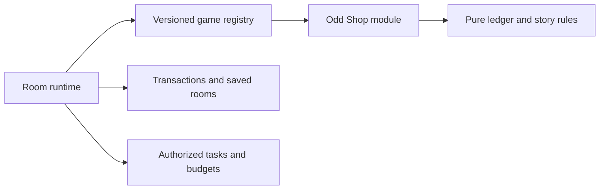

# Playground game modules

`framework/GameModule` defines a pure initialize/reduce/summarize lifecycle. `GameRegistry` selects an exact `(gameId, ruleVersion)` and rejects duplicates, unknown versions and incorrect module types. A module has an independent `stateSchemaVersion`; transport contract versions belong to task validation.

The running `PlaygroundService` uses `OddShopModule` for initialization, economic previews/settlement, annual incident selection and ending summaries. The module delegates established ledger math rather than rewriting it. Demand behavior must match the selected version. Old saved rules 0.4–1.0 remain registered; rule 1.1 changes only causal incident selection and context projection. Its source is an actually executed prior plan, never a proposed or fallback plan.

Pure modules must not call a model, database, current clock or credential provider. Configuration and authorized commands arrive from the runtime. The runtime owns authorization, locks, atomic event/state/task persistence, attempts, idempotency, deadlines and recovery. Model prose does not modify accounts.

`GameRegistryTest` includes a different three-stage exploration fixture with two independent route positions and an explicit safe fallback on disagreement. It uses the same generic interface and registry, without shop currency or reducers. This is a reuse check, not an available game.

Current room orchestration, legal actions, visibility projection and task windows still contain shop logic. Adding a playable game requires its runtime adapter, state parser/migration policy, visibility/legal-action/timeout/public-summary projections and frontend renderer. Do not register a game in the public catalog solely because its pure reducer exists. Extract those runtime interfaces against a real second game rather than inventing a universal action/state format now.

## Rule 1.1 candidate

`PLAYGROUND_STORY_ENABLED` defaults false. With the existing annual feature gates enabled, true selects 1.1 for new FULL wire-contract-5 rooms; false selects 1.0. Saved versions survive restarts and switch changes. `PLAYGROUND_ENRICHED_CONTEXT` also defaults false and can optionally enrich 1.0 tasks once compatible hosts are available. Rule 1.1 always includes own signed responsibilities, finite option effects and nullable incident provenance.

Conditional causal incidents are: expanded production with negative supply reliability; community marketing; fast service with negative relationship trust. A matching previous incident family suppresses the new cause. Otherwise the existing seeded schedule applies. Cause fields identify only the source month and finite choice. No database migration or new owner grant is required.

Host wire contract remains 5; internal validation schemas 6/7 refine rules 1.0/1.1. Deploy updated hosts before enabling either context switch on staging. Backend/FE/host candidates remain draft and production flags remain disabled. Cross-repository verification and limitations are recorded in OBSERVER `docs/PLAYGROUND_FRAMEWORK_INTEGRATION_20261010.md`.
# Release configuration (2026-10-11)

`application.yml` now maps `PLAYGROUND_V6_ENABLED` to `playground.v6-enabled`; previously an environment-only deployment could not activate the annual room gate. A configuration test checks the default-off and explicitly enabled cases without starting a database. This fixes deployment configuration only and does not establish staging or production acceptance. Compatible Hosts must precede annual/enriched tasks.
